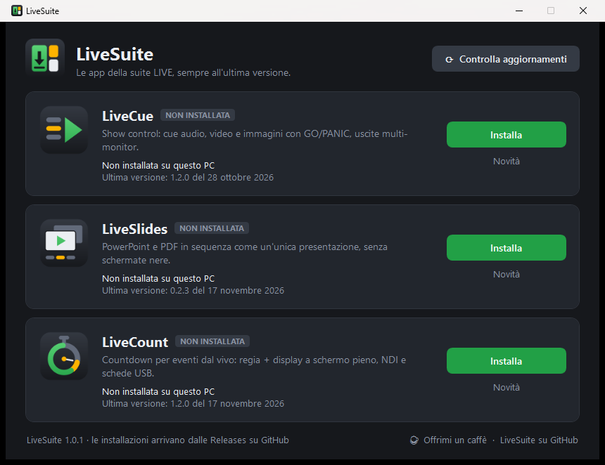

<p align="center"></p>

<h1 align="center">LiveSuite</h1>

<p align="center">Il punto di partenza della suite LIVE: un'unica piccola app per <b>installare e tenere aggiornate</b><br><a href="https://github.com/ncrdavide-svg/LiveCue">LiveCue</a>, <a href="https://github.com/ncrdavide-svg/LiveSlides">LiveSlides</a> e <a href="https://github.com/ncrdavide-svg/LiveCount">LiveCount</a>.</p>

<p align="center">
  <a href="https://github.com/ncrdavide-svg/LiveSuite/releases/latest/download/LiveSuite.exe"><b>⬇ Scarica LiveSuite.exe</b></a> — Windows 10/11, circa 200 KB, nessuna installazione
  <br>
</p>

<p align="center"></p>

---

## Come si usa

1. Scarica **LiveSuite.exe** dal link qui sopra e mettilo dove vuoi (Desktop, chiavetta…). Non si installa.
2. Aprilo. Se compare **«Windows ha protetto il PC»**: *Ulteriori informazioni* → *Esegui comunque* (succede perché il file non ha una firma digitale a pagamento).
3. Per ogni app vedi la versione installata e l'ultima pubblicata:
   - **Installa** / **Aggiorna** scarica l'installer dell'ultima versione e lo avvia;
   - **Apri** avvia l'app già installata;
   - **Novità** apre la pagina della versione su GitHub.

LiveSuite controlla anche se stesso: quando c'è una versione nuova compare un avviso e un clic la sostituisce.

## Come funziona

- Le versioni le legge dalle **Releases di GitHub** di ogni app (`/releases/latest`). Ogni Release deve contenere l'installer con il **nome fisso** `<App>-Setup.exe` (oltre a quello con il numero di versione): è quello che LiveSuite scarica.
- Quale versione è installata lo legge dal registro di Windows, dove la scrive l'installer Inno Setup di ogni app (`AppId` in `src/LiveSuite/Suite.cs`).
- Per **aggiungere un'app** alla suite: una voce in `Suite.cs` e la sua icona PNG in `src/LiveSuite/Assets/`.

## Sviluppo

WPF su **.NET Framework 4.8** (già presente in ogni Windows 10/11): così LiveSuite è un solo `.exe` piccolo, senza runtime da installare.

```
dotnet build src/LiveSuite -c Release
powershell -ExecutionPolicy Bypass -File build.ps1      # → artifacts\LiveSuite.exe
python tools/make_icon.py                               # rigenera l'icona (serve Pillow)
```

### Pubblicare una versione nuova

1. Alza `<Version>` in `src/LiveSuite/LiveSuite.csproj`.
2. `build.ps1`, poi:

```
gh release create v1.0.1 artifacts\LiveSuite.exe --title "LiveSuite 1.0.1" --notes "..."
```

L'asset si deve chiamare esattamente `LiveSuite.exe`: è quello che cercano il link di download e l'aggiornamento automatico.

## Supporta

Se la suite ti è utile, offrimi un caffè: [buymeacoffee.com/cin8](https://buymeacoffee.com/cin8)
